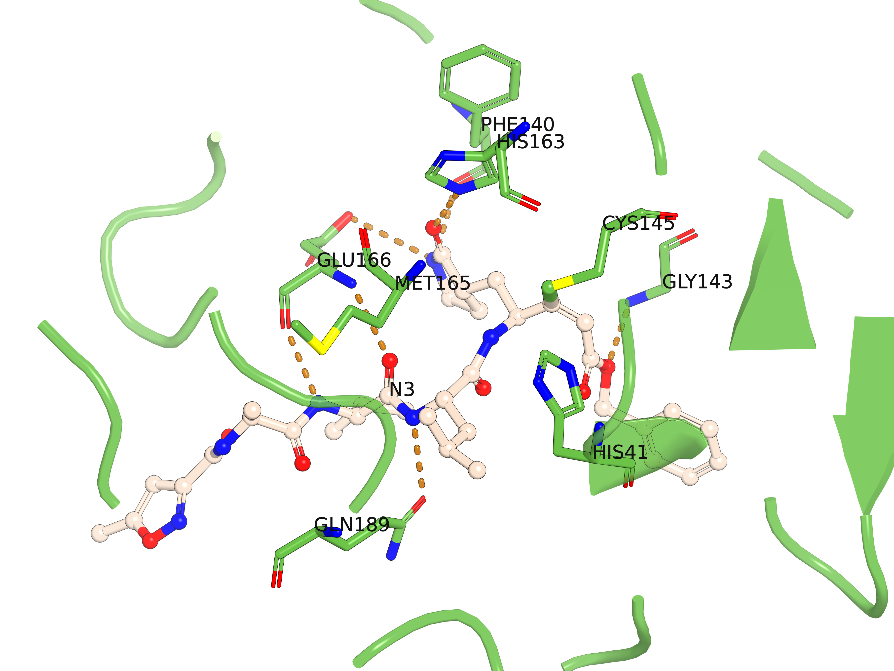

# PyMOL Pocket Figures

A small, original PyMOL extension for making labeled protein–ligand pocket figures from a **structure you load yourself**. It separates displayed residues into individual stick objects, colors a ligand in a thick ball-and-stick style, optionally draws geometric polar contacts, and saves the camera view directly to a high-resolution transparent PNG.

The code contains no bundled structures, ligand coordinates, project results or fixed residue numbers. It was tested with PyMOL 3.1.1; other PyMOL versions may differ in available rendering settings.

## Quick start

1. Load your prepared complex in PyMOL. Check that ligand bond orders are correct; a PDB alone may not preserve aromaticity or double-bond order, so use a chemically typed ligand file or verify the loaded connectivity where necessary.
2. In the PyMOL command line, run:

   ```text
   run /path/to/pocketfigure.py
   pocket_figure complex, resn LIG and chain A, ligand_label=Compound-1, polar_contacts=yes
   ```

   Replace `complex` with your PyMOL object name and `resn LIG and chain A` with a selection that identifies **one ligand** in that object. Nearby protein residues are selected automatically within 4.5 Å. The command prints its generated prefix, such as `pf001`.

3. Rotate and zoom the scene to your preferred angle. Save the current view in one command:

   ```text
   pocket_save pocket_figure.png, 3600, 2700, 600
   ```

   `pocket_save` performs the ray render itself. There is no separate `ray` step. The default PNG has a transparent background; the PyMOL viewport can still appear white.

For selected residues rather than an automatic distance shell:

```text
pocket_figure complex, resn LIG and chain A, residue_selection=chain A and resi 42+57+103, ligand_label=Compound-1
```

For a second complex in the same session, run `pocket_figure` again with its object and ligand selection. Each run receives a fresh prefix (`pf001`, `pf002`, ...). By default, other loaded objects are disabled so that the chosen complex is isolated in the figure; set `isolate=no` to preserve their visibility.

## Worked example: PDB 6LU7



*Figure: PyMOL rendering by Raphael Onuku of deposited N3 in the 6LU7 main-protease pocket. Green sticks show the eight selected protein residues; cream ball-and-stick shows N3; amber dashes are PyMOL geometric polar-contact suggestions.*

[PDB 6LU7](https://www.rcsb.org/structure/6LU7) is SARS-CoV-2 main protease with the covalent inhibitor N3. In the deposited PDB file, N3 is **chain C spanning residues 1–6**, rather than a residue named `N3`; its PJE5 C20 atom is linked to protein Cys145 SG. With the PDB loaded as the PyMOL object `6LU7`, use:

```text
run /path/to/pocketfigure.py
pocket_figure 6LU7, chain C, residue_selection=chain A and resi 41+140+143+145+163+165+166+189, ligand_label=N3, polar_contacts=yes
```

Rotate the view, then export exactly that view:

```text
pocket_save 6LU7_N3_pocket.png, 3600, 2700, 600
```

This eight-residue view is a compact visualization example, not a complete interaction inventory. The script excludes the selected ligand from the protein cartoon and residue sticks even when part of the inhibitor is typed as protein, and retains the deposited Cys145–N3 covalent link. The amber dashes are geometric polar-contact suggestions, distinct from that covalent bond. If your PyMOL object has another name, replace only `6LU7` in the command.

## Parameters

| Parameter | Default | Purpose |
| --- | --- | --- |
| `object_name` | required | Name of a loaded PyMOL molecular object. |
| `ligand` | required | PyMOL selection for the ligand inside that object. |
| `residue_selection` | `auto` | PyMOL selection for protein residues; `auto` uses the ligand-distance shell. |
| `residue_radius` | `4.5` Å | Distance used to select residues in automatic mode. |
| `cartoon_radius` | `8.0` Å | Distance used for the surrounding protein cartoon. |
| `ligand_label` | ligand residue name | Text placed near a central ligand atom. |
| `polar_contacts` | `no` | `yes` asks PyMOL to draw mode-2 polar-contact dashes. |
| `contact_cutoff` | `3.6` Å | Maximum distance for the optional polar-contact search. |
| `isolate` | `yes` | Disable other loaded objects in the view. |
| `prefix` | automatic | Prefix for generated selections and residue objects. |

`pocket_save filename.png, width, height, dpi` defaults to 3600 × 2700 pixels at 600 dpi. The command exports the **current** camera view.

## What the figure means

One temporary PyMOL object is created for each displayed amino-acid residue. This suppresses peptide links **between displayed residue sticks** so individual side chains are easier to read. The original molecular object, coordinates and bonds are left intact. Residue labels use three-letter residue names plus numbers; a chain identifier is added automatically if two displayed chains have the same residue name and number. Labels are attached to the residue Cα atom where present.

Amber dashes from `polar_contacts=yes` are PyMOL's geometric polar-contact suggestions. They are **not covalent bonds** and should be checked against atom types, hydrogen orientation and distances before a manuscript assigns specific hydrogen bonds. The tool does not calculate binding affinity or validate a docking pose.

For accurate chemical depictions, inspect the structure before exporting: correct ligand identity and bond order, biological assembly, alternate conformers, atom naming, relevant cofactors and waters, and residue numbering. The script styles the supplied model; it does not repair it.

## Testing

Run the integration smoke test with a Python interpreter from a working PyMOL installation:

```text
/path/to/pymol/bin/python tests/smoke_test.py
```

The test creates a small synthetic protein–ligand structure in memory, checks residue separation and labels, and verifies that the input object's coordinates remain unchanged. No project structure is needed.

## License

MIT; see [LICENSE](LICENSE). This implementation was written specifically as a reusable PyMOL extension and does not include code from third-party rendering gists.
